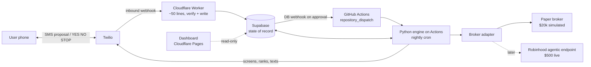

# Stock Trader — Design Spec

- Status: awaiting user review
- Date: 2026-11-27
- Project folder: `stock-trader`

## 1. Purpose

Build a swing-trading bot that picks high-conviction US stocks and only ever
trades after the user approves a proposal by text message. The objective is to
maximize profit while minimizing risk, risking 1% of account equity per trade.

Decisions locked in conversation:

- Swing trading: hold days to weeks. Long-only. No shorts, options, or margin.
- Paper trading first with a $20,000 account; live later with a $500 Robinhood
  account.
- Hybrid picker: safety screener shortlists the universe, an ML model ranks it,
  and news features feed the model.
- Confidence-gated texts: the bot texts only when a pick clears the confidence
  bar, never on a fixed daily schedule.
- No fixed dollar profit target (the earlier $200 floor was dropped). Exits are
  risk/reward-driven.
- Runtime: GitHub Actions (Python engine) + a thin Cloudflare Worker + Supabase
  (free tier) + Twilio SMS + a static dashboard on Cloudflare Pages.
- A simple dashboard is in scope.

## 2. Non-goals

- No day trading or intraday signals.
- No shorting, options, margin, or crypto.
- No fully automatic trading: orders are only ever placed after a text approval.
- Single user, single approved phone number, single account per phase.
- No backtesting UI beyond the dashboard's reporting views.

## 3. Architecture

Five pieces, one source of truth:



Components:

- **Python engine (GitHub Actions)** — one codebase, two triggers: a nightly
  cron run for signals and exit review, and a `repository_dispatch` run for
  executing approvals. All trading logic lives here.
- **Cloudflare Worker** — receives Twilio's inbound-SMS webhook, verifies the
  Twilio request signature and the sender's phone number, and writes the parsed
  YES/NO/STOP reply to Supabase. No trading logic; written once, expected never
  to change.
- **Supabase (free tier)** — Postgres is the single source of truth for
  signals, proposals, approvals, orders, positions, trades, and alerts. Row
  Level Security restricts reads; a database webhook fires on approval inserts.
- **Twilio** — outbound proposal, confirmation, and alert texts; inbound
  replies.
- **Broker adapters** — `PaperBroker` now, `RobinhoodBroker` later, behind one
  interface. No strategy code changes at the switch.
- **Dashboard** — static app on Cloudflare Pages, read-only views over Supabase.

## 4. Components in detail

### 4.1 Signal engine (nightly cron, ~17:00 CT on trading days)

1. Fetch end-of-day bars (yfinance, free, no API key) and recent headlines
   (Finnhub free tier) for the candidate universe.
2. Run the safety screener: share price at least $5, minimum average dollar
   volume (tunable, default $10M), no earnings announcement within two days of
   the signal date, close above a long-term moving average. Thresholds are
   configurable from the dashboard.
3. Build features: momentum at several horizons, volatility, volume trends,
   drawdown behavior, relative strength, plus the news features (see 5.2).
4. Rank with the ML model and calibrate probabilities.
5. Apply the confidence gate (tunable threshold). No text goes out below it.
6. Check capacity: at most 5 concurrent positions (tunable), one pending
   proposal at a time, and never propose a ticker already held.
7. Run the daily exit review over open positions: stop management, trailing,
   time cap.
8. Run the reconciliation sweep and circuit-breaker check (section 8).
9. Text the proposal: ticker, size, stop, one-line rationale, confidence,
   proposal ID.

### 4.2 Execution engine (`repository_dispatch` trigger)

1. Load the approval by its idempotency key and verify the trade is still
   `APPROVED` and unexpired.
2. Recompute position size against the current price; enforce the 1% risk rule
   at execution time, not just signal time.
3. Submit through the broker adapter. Paper fills at the reference quote plus a
   slippage assumption; after-hours approvals queue to the next market open.
4. Update the trade state machine and send a confirmation text.

### 4.3 Cloudflare Worker

- Endpoint `POST /sms-webhook`.
- Verify Twilio's `X-Twilio-Signature`; reject forged requests.
- Verify the `From` number is the whitelisted user.
- Parse `YES`, `NO`, `STOP` (case-insensitive).
- Write the approval row with the proposal's idempotency key. Duplicate writes
  are no-ops.
- Nothing else. No secrets beyond Twilio and Supabase credentials.

### 4.4 Supabase schema

- Tables: `signals`, `proposals`, `approvals`, `orders`, `positions`, `trades`,
  `alerts`, `settings`.
- Each trade carries a state column and an audit trail of transitions.
- Row Level Security: the dashboard's anon key can only read restricted views.
- Database webhook on `approvals` insert posts to GitHub's `repository_dispatch`
  API using a workflow-scoped PAT.

### 4.5 Broker adapters

Interface:

```text
get_quote(symbol)
submit_order(symbol, side, qty, order_type, client_id)
cancel_order(order_id)
get_positions()
get_account()
```

- `PaperBroker`: $20k virtual cash, fills at the latest quote plus a small
  slippage assumption, every fill logged. Realistic enough to catch logic bugs,
  honest enough to tune slippage during the dry run.
- `RobinhoodBroker`: the official agentic trading endpoint (beta, OAuth,
  equities-only, orders execute in a dedicated separately-funded agentic
  account; other accounts stay read-only). The adapter previews orders before
  placing them and stores the OAuth refresh token in GitHub secrets. The
  community `robin_stocks` library remains a documented fallback if the beta
  changes.

### 4.6 Dashboard (Cloudflare Pages)

- Overview: equity curve, open positions, realized/unrealized P&L.
- Signal history with confidence scores and the reasoning line.
- Proposal/approval history and current kill-switch status.
- Settings: confidence threshold, max positions, drawdown breaker threshold.
- Read-only; all writes go through the engine or the Worker.

### 4.7 Twilio and keywords

- Outbound: proposal, confirmation, and alert texts.
- Inbound: `YES` approves, `NO` rejects, `STOP` pauses all trading immediately
  (confirmed by text, resumable from the dashboard).

## 5. Strategy and risk rules

### 5.1 Risk per trade

- Risk exactly 1% of current account equity per trade.
- Position size = `(equity * 0.01) / (entry - stop)`; a wider stop means a
  smaller position.
- Initial stop is ATR-based. Move to breakeven after +1R, then trail.
- Recompute at execution time because the stop distance moves with price.

### 5.2 News features

- Headline sentiment over the trailing week, computed with a finance-tuned
  lexicon hybrid (free, no key); FinBERT is the documented upgrade path.
- News volume: is the name newly in the news at all?
- Shock flag: unusual price movement coinciding with a news spike.
- Leakage guard: a headline only counts if published before the signal date.
- Free news history is short (~1 year on Finnhub free), so news features are
  validated on that window and gated out of older backtest rows rather than
  backfilled.

### 5.3 Exits

- No fixed dollar target. The bot re-runs its read daily and holds while the
  model's expected reward justifies the remaining risk.
- Time cap (tunable, default 30 calendar days) so positions cannot rot.
- Long-only; exits are the only action the engine may take without a text, and
  every exit is confirmed by text and logged.

### 5.4 Circuit breaker

- If the account draws down 5% or more within a week (tunable), the engine
  pauses new proposals and texts the user. Manual resume from the dashboard.

## 6. Trade lifecycle and approvals

States:

```text
PROPOSED -> APPROVED -> ORDER_SUBMITTED -> FILLED -> OPEN -> EXIT_SUBMITTED -> CLOSED
PROPOSED -> REJECTED
PROPOSED -> EXPIRED        (no reply by next market open)
ORDER_SUBMITTED -> CANCELLED
```

- Proposal expiry: next market open. The executor re-checks freshness at
  execution time, so a late YES cannot revive a stale proposal.
- Idempotency: one approval key per proposal; broker-side client order IDs make
  duplicate submission impossible.
- After-hours approvals queue to the next market open.

## 7. Data flows

- **Nightly cycle**: fetch data -> screen -> features (price + news) -> rank ->
  confidence gate -> capacity check -> proposal text. Then exit review,
  reconciliation sweep, breaker check. All results written to Supabase.
- **Approval cycle**: user reply -> Twilio webhook -> Worker verification ->
  approval row -> Supabase DB webhook -> GitHub dispatch -> Python executor ->
  order via broker adapter -> confirmation text.
- **Exit cycle**: nightly review decides stops/exits -> engine submits exit
  orders -> confirmation text -> state update.

## 8. Error handling and safety

- Idempotency everywhere: approval keys and client order IDs prevent
  double-execution under webhook retries or overlapping jobs.
- Reconciliation sweep: any approval that lands but doesn't execute is picked up
  by the next engine run. Missed work is late work, never lost work.
- Stuck-state self-reporting: a submitted order without a fill, or a position
  past its time cap, generates an alert text.
- Market calendar guard: nothing is submitted outside market hours except
  queued-for-open orders. Exchange holidays respected.
- Only the whitelisted phone number can approve; everything else is logged and
  ignored.
- Secrets live only in GitHub Actions and the Worker environment: Twilio, the
  Supabase service key, the dispatch PAT, and later the Robinhood OAuth token.
- Job failures (data fetch, webhook, execution) always produce an alert text;
  silence never means success.
- `STOP` kill switch pauses all trading instantly.

## 9. Testing and validation

- **Unit tests**: screener rules, 1% risk math (sizing, ATR stops, breakeven,
  trailing), news pipeline with the leakage guard, trade state machine,
  idempotency keys.
- **Backtest harness**: chronological walk-forward splits, costs included
  (commission + slippage), benchmarked against buy-and-hold on Sharpe, max
  drawdown, profit factor, and win rate. The model must clear a pre-agreed bar
  — positive out-of-sample Sharpe after costs — before the confidence gate may
  text anyone.
- **Integration tests**: the full chain with a fake broker adapter and mocked
  Twilio — Worker signature and whitelist checks, malformed inputs, the
  Supabase-webhook-to-dispatch hop, execution, and confirmation texts.
- **Dry run**: at least two weeks running the full paper loop on live market
  data before any real money moves; a shadow phase precedes the Robinhood
  switch.

## 10. Configuration and deployment

- GitHub Actions workflows:
  - `signal.yml` — cron on trading days (~17:00 CT; the cron expression is UTC
    and adjusted for daylight saving), plus `workflow_dispatch`.
  - `execute.yml` — `repository_dispatch` trigger for approvals.
- Worker deployed with `wrangler`; Supabase schema managed with migrations;
  Twilio number configured to point its inbound webhook at the Worker; dashboard
  deployed to Cloudflare Pages.
- GitHub Actions free tier covers the volume (roughly one signal run per
  trading day plus occasional execution runs).

## 11. Milestones

- **M0** — repo, this spec, implementation plan.
- **M1** — data pipeline, screener, backtest harness, dashboard skeleton.
- **M2** — ML ranker + news pipeline + confidence gate; proposals are
  dashboard-only at this stage, no texts yet.
- **M3** — full paper loop: Worker, Supabase webhook, Twilio, paper broker.
- **M4** — multi-week dry run; tune thresholds, slippage, and the confidence bar.
- **M5** — dashboard complete; alerts and circuit breaker verified.
- **M6** — Robinhood adapter behind the same interface; small live account
  ($500), shadow mode first.

## 12. Assumptions and known risks

- Free market data is end-of-day and slightly delayed — acceptable for
  days-to-weeks holds.
- Free news history (~1 year) limits how far back news features can be
  validated; the model is trained without news on older data.
- The Robinhood agentic endpoint is in beta, equities-only, and may change; the
  adapter isolates the system from that, with `robin_stocks` as a fallback.
- GitHub Actions cron timing is best-effort; delays of minutes are acceptable
  for swing trading and the reconciliation sweep covers missed triggers.
- Supabase free tier pauses after about a week without traffic; the daily
  signal run prevents this.
- Twilio costs a monthly number fee plus per-message fees (roughly a couple of
  dollars a month at this message volume).
- Paper fills approximate real execution; slippage assumptions are validated
  during the dry run.
